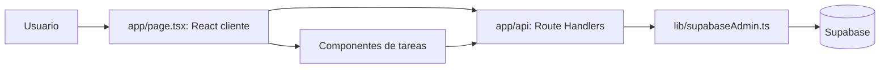

# Arquitectura y funcionamiento

## Flujo de datos

El navegador consume rutas relativas con `fetch`. Solo el servidor importa el cliente administrativo. No hay suscripciones Realtime ni acceso directo del navegador a Supabase en los componentes revisados.

## Estructura

| Archivo o directorio | Responsabilidad |
| --- | --- |
| `app/page.tsx` | Estado, formularios, carga de datos, relojes, audio y reordenamiento |
| `app/layout.tsx` | Documento raíz, fuentes y metadatos |
| `app/globals.css` | Tailwind y estilos globales |
| `app/api/**/route.ts` | Validación, consultas, escrituras y respuestas JSON |
| `components/TaskCard.tsx` | Edición, vencimiento, expansión y avance de tareas |
| `components/SubtaskList.tsx` | Crear, completar y borrar pasos |
| `components/ProgressBar.tsx` | Barra de progreso limitada visualmente a 0–100 |
| `lib/taskTypes.ts` | Tipos Task/Subtask, progreso y orden por fecha |
| `lib/supabaseAdmin.ts` | Cliente servidor y comprobación de variables |

## Carga y persistencia

Al montar la página se cargan temporizadores, pensamientos, cronómetros, notas y tareas. Cada tarea requiere otra solicitud para cargar sus pasos. Las mutaciones recargan sus colecciones correspondientes.

Los registros persisten en Supabase. Los relojes activos, la fase Pomodoro y el contador de ciclos solo viven en React: se pierden al recargar o cerrar. No hay restauración por localStorage. Las fechas de los historiales usan la configuración regional del navegador.

## Relojes

- Temporizador: calcula el tiempo desde un instante objetivo, refresca cada segundo y guarda un registro al iniciar, aunque se detenga antes de terminar. Al dejar de correr, un efecto restaura la duración configurada.
- Cronómetro: calcula la duración desde el inicio; detener guarda inicio, fin y segundos. Reiniciar descarta la sesión activa sin guardarla.
- Pomodoro: valores iniciales de 25 minutos de enfoque y 5 de descanso. Crea una sesión al iniciar; al llegar a cero intenta completarla, cambia de fase y queda detenido hasta un nuevo inicio. El contador aumenta tras cada enfoque.
- Pausar Pomodoro no conserva tiempo para reanudar: el siguiente inicio utiliza la duración completa de la fase y puede reutilizar el mismo ID de sesión. Reiniciar abandona la sesión sin completarla.
- La alarma usa Web Audio, con osciladores y ganancia. La suspensión de la pestaña puede retrasarla; no existe proceso servidor de alarmas ni notificaciones push.

## Tareas

El avance es `100 × suma de pesos completados / suma de pesos`. Sin pasos o con peso total no positivo devuelve 0. Un paso completado de peso 3 y otro pendiente de peso 1 producen 75 %.

El servidor ordena por fecha ascendente, sin fecha al final y posición como desempate. El arrastre guarda posiciones y no sustituye la prioridad de fecha. El comparador cliente presenta un caso distinto: resta infinitos cuando ambas tareas no tienen fecha y devuelve NaN antes del desempate por posición.

La fecha límite se interpreta a medianoche local. Los días anteriores se marcan vencidos y los siguientes tres días, incluido hoy, próximos. La etiqueta de tiempo restante puede indicar vencimiento en el propio día límite porque su instante final es la medianoche.

## Módulo independiente de pendientes

`/api/todos` utiliza `todo_items`, con prioridad y estado completado. No es la tabla `tasks` y no tiene consumidor en la página actual. La mayoría de la lógica de los otros módulos está concentrada en `app/page.tsx`; solo las tareas tienen componentes propios.
