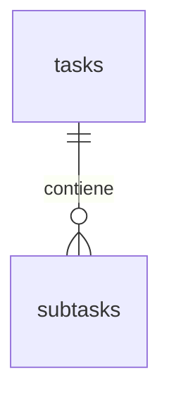

# Modelo de datos

Inventario deducido de consultas y tipos TypeScript. No es un volcado del esquema remoto ni una migración verificada. No hay SQL, migraciones ni políticas RLS versionadas. Los tipos siguientes son expectativas de la aplicación, no confirmaciones del DDL real.

| Tabla | Columnas consumidas |
| --- | --- |
| timer_logs | id numérico; configured_minutes numérico; executed_at, created_at fechas; label texto nullable |
| stopwatch_logs | id numérico; label texto nullable; started_at, ended_at, created_at fechas; duration_seconds entero |
| pomodoro_sessions | id numérico; phase texto focus/break; duration_minutes, cycle_number enteros; started_at, completed_at fechas |
| thought_logs | id numérico; content texto; created_at fecha |
| notes | id numérico; title texto nullable; content texto; created_at, updated_at fechas |
| tasks | id UUID; title texto; description texto nullable; position entero; due_date fecha nullable; created_at, updated_at fechas |
| subtasks | id y task_id UUID; title texto; weight entero; completed booleano; completed_at fecha nullable; created_at, updated_at fechas |
| todo_items | id numérico; title texto; description texto nullable; priority y position enteros; completed booleano; completed_at nullable; created_at, updated_at fechas |

## Relación

subtasks.task_id referencia lógicamente tasks.id. La existencia de una clave foránea no está comprobada. El borrado de tareas depende de una cascada u otra estrategia en la base de datos: el servidor no borra los pasos explícitamente.

## Valores y mecanismos requeridos

- Las creaciones omiten IDs, por lo que la base de datos debe generarlos. Pomodoro solo conserva el ID cliente si llega como número JSON.
- created_at y updated_at se omiten al insertar; la base de datos debe suministrarlos para sostener los tipos y el orden esperados.
- La aplicación no actualiza updated_at. Para reflejar modificaciones hace falta un mecanismo de base de datos, como un trigger; no se ha comprobado que exista.
- Crear pasos omite completed y completed_at; el comportamiento esperado necesita pendiente y null por defecto.
- Crear Pomodoro omite completed_at; una sesión en curso necesita null.

## Cómo reconstruir el entorno

1. Obtener el DDL real del proyecto Supabase sin datos personales ni secretos.
2. Revisar tipos, generación de IDs, valores por defecto, índices, claves foráneas y triggers contra este inventario.
3. Revisar RLS y privilegios junto con el acceso servidor: el cliente administrativo no ofrece aislamiento por usuario.
4. Versionar migraciones revisadas y aplicarlas a una base de desarrollo.
5. Verificar creación, edición, orden y borrado por módulo.

La documentación no ejecuta SQL ni modifica la base de datos remota.
